## Where we are

- So far we have been reading other people's experiments.
- From now on you are building your own.

## Today

1. Experiments
2. Theories
3. Measurement
4. Estimation

# Experiments

## Describing causal relationships

Does money make people happy?

- An **observational study**: ask people how much money they make and how happy they are.
- Suppose the two are correlated.

::: {.prompt}
Can we conclude that money causes happiness?
:::

## Directionality and confounding

:::: {.columns}
::: {.column width="35%"}
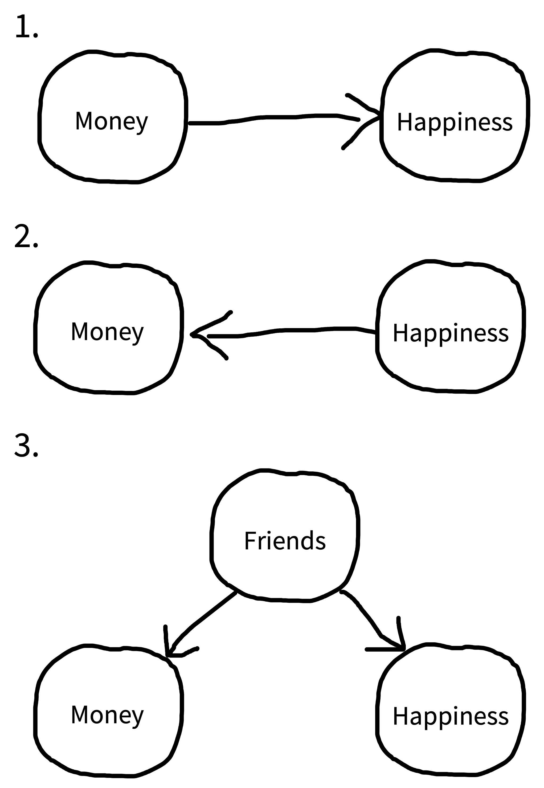{fig-alt="Three causal diagrams: money causes happiness; happiness causes money; friends cause both money and happiness."}
:::
::: {.column width="65%"}
- The same correlation fits all three.
- In the third one, friends is a **confound**.
- Then the correlation is a **biased** estimate of the causal effect.
:::
::::

## Experiments help us answer causal questions

:::: {.columns}
::: {.column width="45%"}
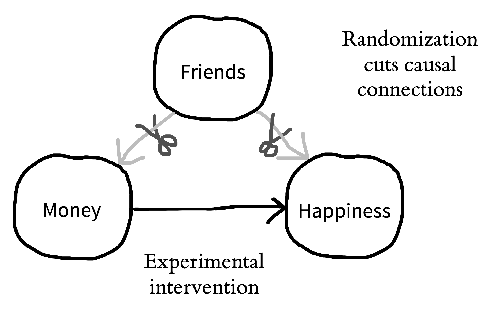{fig-alt="Causal diagram: the arrows from friends to money and to happiness are cut with scissors; an experimental intervention sets money, which points to happiness."}
:::
::: {.column width="55%"}
- Imagine a copy of the world where everybody gets $1,000.
- Everything else is the same.
- We **manipulate** money and **measure** happiness.
:::
::::

## We can't hold people constant

- With cakes you can change only the oven temperature.
- With people you can't.
- Same number of friends in each group? What about education? Sleep?
- Matching only handles the confounds you know about.

## Randomization saves the day

:::: {.columns}
::: {.column width="42%"}
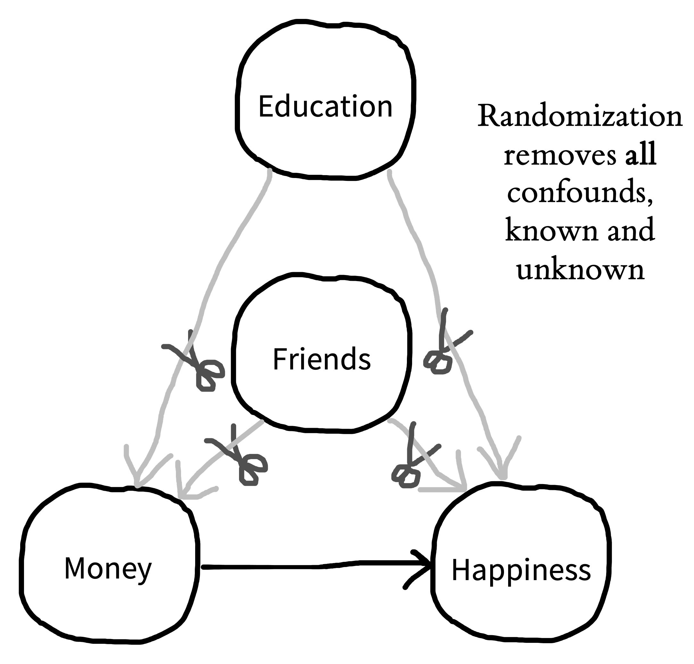{fig-alt="Causal diagram: the arrows from friends and from education to money and to happiness are cut; an experimental intervention sets money, which points to happiness."}
:::
::: {.column width="58%"}
- Randomly assign people to a money group and a no-money group.
- These are the **conditions**.
- On average the groups are similar, even on confounds you did not think of.
- There is still noise.
:::
::::

# Theories

## Psychological constructs

- "How happy are you?" from 1 to 10. Someone says 8.
- Is that really how happy they are?
- Happiness is a **latent construct**. The rating is a **measure** of it.

## Operationalization

Going from a construct to a measure or a manipulation.

::: {.prompt}
How else could you operationalize happiness?
:::

## Example: agreement

- Imagine I want to learn how the mind works when people do agreement.
- I look at every instance of agreement in a corpus of English.
- About 4 errors in every 1,000 sentences. Okay. That does not tell me much.
- Maybe people make more errors when the verb and the subject are far away from each other?

## Example: distance

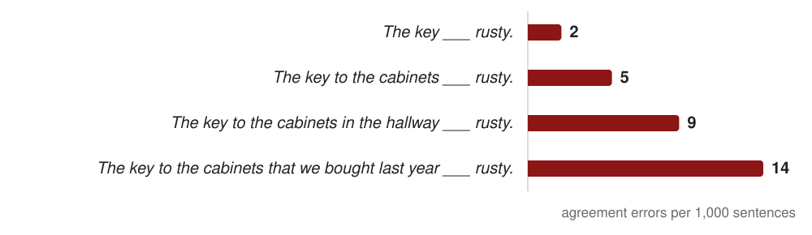{fig-alt="Bar chart of agreement errors per 1,000 sentences. The key blank rusty: 2. The key to the cabinets blank rusty: 5. The key to the cabinets in the hallway blank rusty: 9. The key to the cabinets that we bought last year blank rusty: 14."}

::: {.prompt}
So does the distance cause the errors?
:::

## Example: which direction?

:::: {.columns}
::: {.column width="50%"}
::: {.fragment}
{fig-alt="Causal diagram 1: length causes error."}

The subject gets long, and by the time the verb comes people have lost track of *key*.
:::
:::
::: {.column width="50%"}
::: {.fragment}
{fig-alt="Causal diagram 2: error causes length."}

People are in a "psychological space" where they are about to make an error, so they add more stuff before the verb.
:::
:::
::::

::: {.fragment}
So even in this simple agreement example we can see the directionality problem.
:::

## Example: something else?

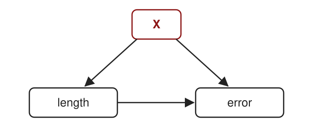{.nostretch height=300 fig-alt="Causal diagram: X causes length, X causes error, and length causes error."}

Maybe length does affect errors, **but** something else also affects length and also increases the errors.

::: {.prompt .fragment}
Can you think of something?
:::

## Example: what could X be?

:::: {.columns}
::: {.column width="50%"}
{fig-alt="Causal diagram: X causes length, X causes error, and length causes error."}
:::
::: {.column width="50%"}
- Maybe it is semantic complexity, there are too many things?
- Maybe the meaning is just difficult?
- Maybe it is structural complexity, like too many DPs, NPs, relative clauses?
:::
::::

## Example: how do we get around this?

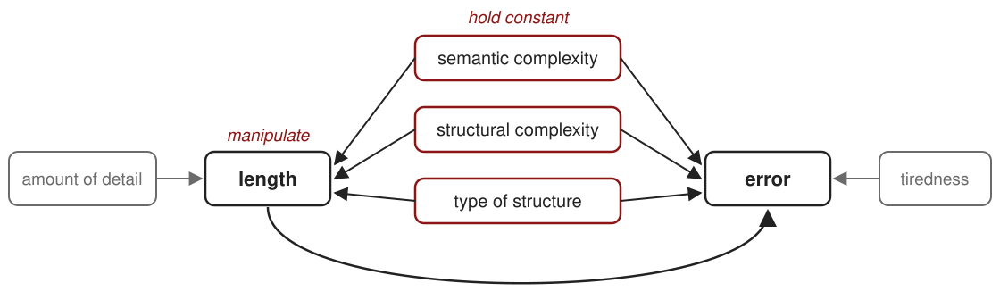{fig-alt="Causal diagram. Semantic complexity, structural complexity, and type of structure each point to both length and error, labelled hold constant. Length points to error and is labelled manipulate. Amount of detail points only to length. Tiredness points only to error."}

## Example: the plan

- First, narrow it down.
- We manipulate length ourselves.
- We keep the red ones the same in every condition.
- We operationalize all of them. What counts as length?

::: {.prompt .fragment}
But how? You have to have some model of what might be going on.
:::

## The relationships between constructs

:::: {.columns}
::: {.column width="42%"}
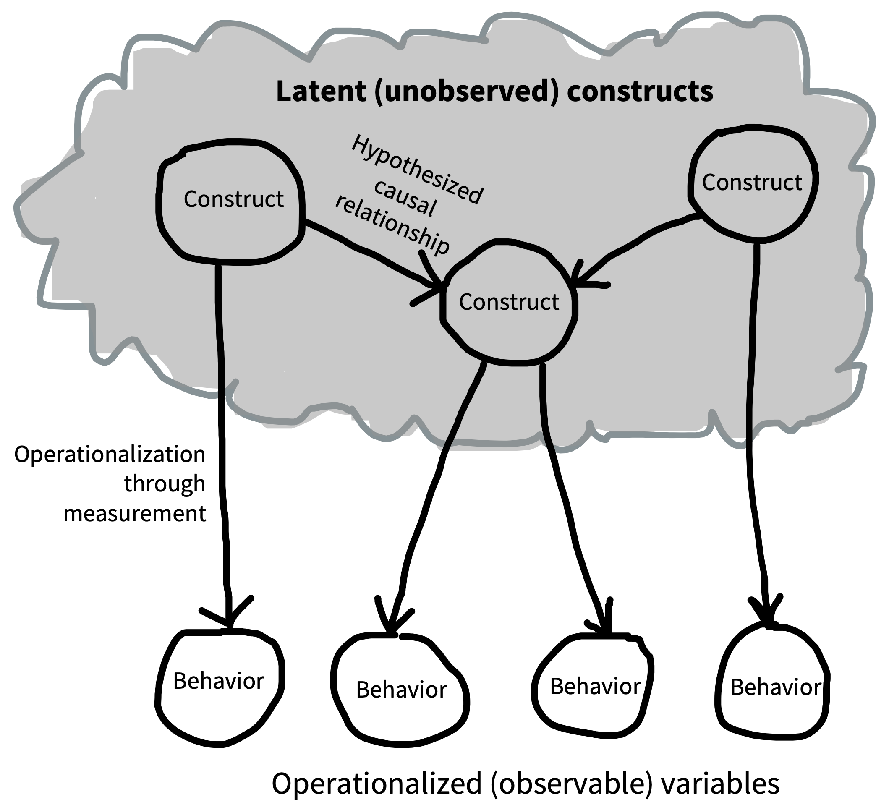{fig-alt="Latent constructs connected by causal arrows, each pointing to one or more observable variables."}
:::
::: {.column width="58%"}
- A theory is a set of causal links between constructs.
- We only get to see the measures.
- A theory should **explain** old data and **predict** new data.
:::
::::

## A holistic viewpoint on theory testing

- You give someone money and they are not happier. Do we throw out the theory?
- Maybe the measure was wrong, or the amount, or the timing.
- These are **auxiliary assumptions**.
- You cannot test one hypothesis on its own (**holism**).
- Kuhn: scientists mostly work inside a **paradigm**.

## Designing experiments to test theory

:::: {.columns}
::: {.column width="38%"}
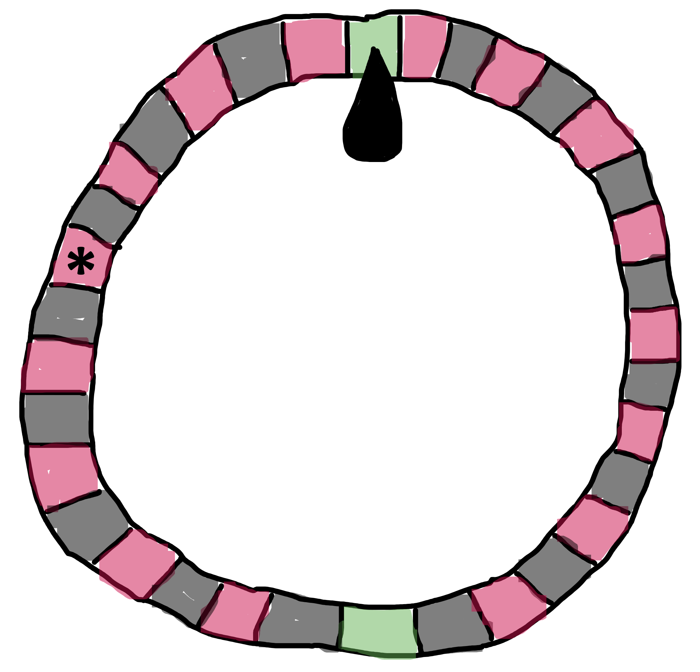{fig-alt="A roulette wheel with alternating red and black segments; one segment is marked with an asterisk."}
:::
::: {.column width="62%"}
- A theory lets you make a bet.
- One number is riskier than red.
- Verbal theories usually only predict a direction.
- Best is when two theories predict different things.
:::
::::

## A risky test we read

Both hypotheses predict a congruency effect in the singular.

| | Singular: *der Stuhl* | Plural: *die Stühle* |
|---|---|---|
| Gender selection (GSIH) | effect | effect |
| Determiner selection (DSIH) | effect | [no effect]{.hl} |
| Experiment 1a | +20 ms | −9 ms |

::: {.prompt}
Where do the two hypotheses bet differently? Who won?
:::

::: footer
Week 7: Schiller & Caramazza 2003, p. 172 and Table 1
:::

# Measurement

## Measurement scales

- **Nominal:** unordered categories, like error type.
- **Ordinal:** ordered, like education level.
- **Interval:** numbers with no true zero, like IQ.
- **Ratio:** numbers with a true zero, like reaction time.

## Measurement scales: easy?

It seems easy, but it is important to understand them.

::: {.prompt}
For example, a rating from 1 to 7. Is it interval or ordinal?
:::

## The problem: measurement error

- Measure someone's height five times: 171, 172, 171, 173, 172 cm.
- They have one true height. The rest is **measurement error**.
- Now ask someone how happy they are, five times.

::: {.prompt}
Would you get the same number every time?
:::

## Reliability

:::: {.columns}
::: {.column width="40%"}
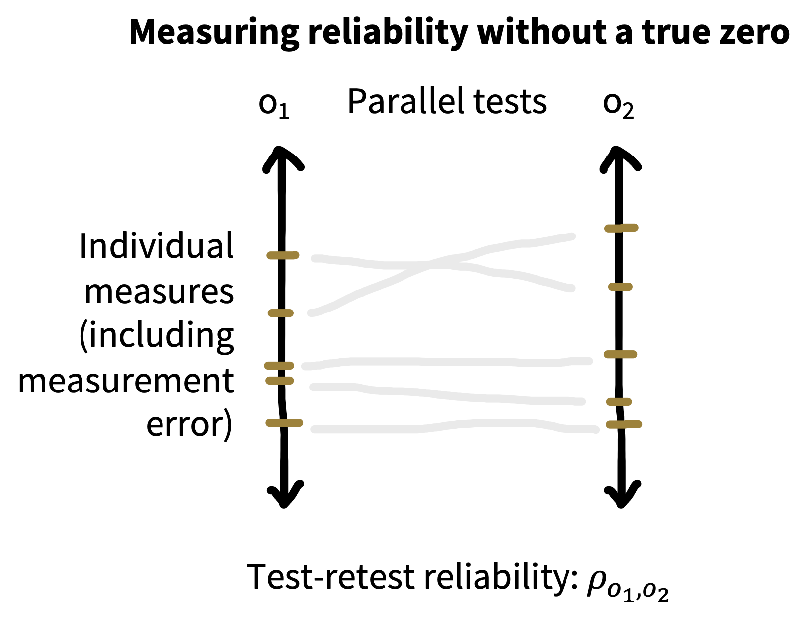{fig-alt="Two parallel line segments, test and retest, with each participant's pair of scores connected."}
:::
::: {.column width="60%"}
- A reliable measure gives about the same answer when you measure again.
- To check, measure the same people twice and see if the scores agree.
- With a reliable measure you need fewer participants.
:::
::::

## Validity

Does the measure measure the construct?

- **Face:** it looks like the construct.
- **Ecological:** it relates to people's real lives.
- **Internal:** nothing about the testing gets in the way, like fatigue.

## Validity, continued

- **Convergent:** it goes with other measures of the same construct.
- **Predictive:** it predicts later outcomes.
- **Divergent:** it differs from measures of other constructs.

## How to select a good measure?

- First, try a measure that already exists.
- If you make one up, you have to show it is reliable and valid.

## Simple vs. complex behaviors

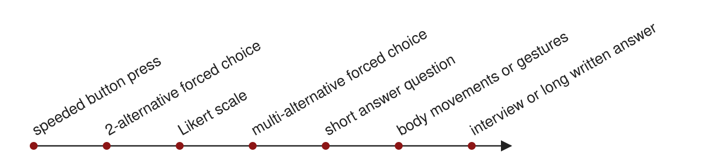{fig-alt="A line of measures from simple to complex: speeded button press, 2-alternative forced choice, Likert scale, multi-alternative forced choice, short answer question, body movements or gestures, interview or long written answer."}

:::: {.columns}
::: {.column width="50%"}
- More constrained, fewer alternatives
- Less information content
- Easier to analyze
- Easier to use with children, animals, etc.
:::
::: {.column width="50%"}
- More open-ended
- Greater information content
- Harder to analyze using quantitative methods
- More affected by other factors, e.g., task, language skill, etc.
:::
::::

## Implicit vs. explicit behaviors

:::: {.columns}
::: {.column width="50%"}
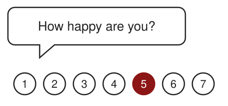{fig-alt="A speech bubble asking How happy are you, above a rating scale from 1 to 7 with 5 selected."}

::: {.fragment}
**Explicit:** they are aware of their answer.
:::
:::
::: {.column width="50%"}
::: {.fragment}
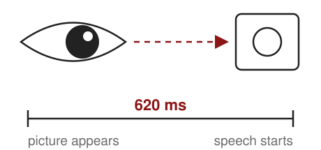{fig-alt="An eye looking at a picture, above a timeline from picture appears to speech starts labelled 620 milliseconds."}
:::

::: {.fragment}
**Implicit:** they cannot report it. Eye gaze, response time.
:::
:::
::::

## Speed-accuracy trade-off

Payne 2001: identify a tool or a gun after a face prime.

| | Reaction time | Errors |
|---|---|---|
| No deadline | [differs by prime]{.hl} | similar |
| Deadline | equal | [differ by prime]{.hl} |

## The temptation to measure lots of things

The book's advice is to pick one good measure.

- Participants get tired.
- More measures means more bets.
- It is tempting to report only the ones that worked.

::: {.prompt}
If two measures disagree, which one do you believe?
:::

# Estimation

## Estimating the treatment effect

:::: {.columns}
::: {.column width="48%"}
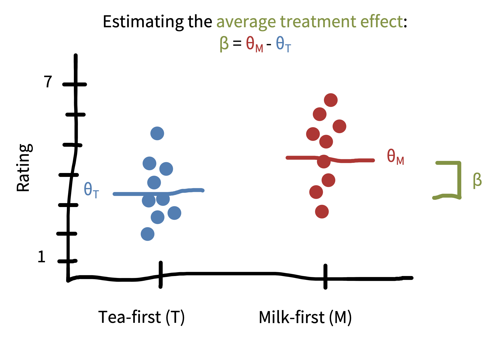{fig-alt="Ratings for tea-first and milk-first cups, each with its mean; beta is the difference between the two means."}
:::
::: {.column width="52%"}
- Tea tasting: milk-first and tea-first ratings.
- The **treatment effect** $\beta$ is the shift between the two means.
- Our estimate $\widehat{\beta}$ is the difference between the sample means.
:::
::::

## Standard errors

:::: {.columns}
::: {.column width="42%"}
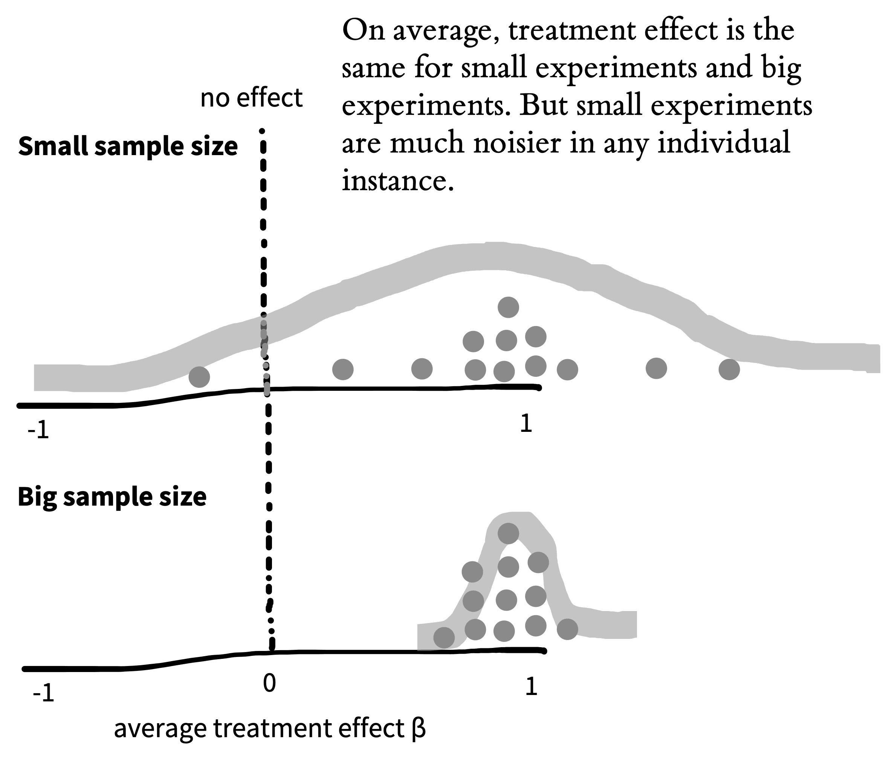{fig-alt="Two sampling distributions of the treatment effect: wide for a small sample, narrow for a large sample."}
:::
::: {.column width="58%"}
- Imagine running the tea experiment thousands of times.
- $\widehat{\beta}$ comes out a bit different each time.
- That distribution is the **sampling distribution**.
- Its standard deviation is the **standard error**.
- More people, narrower distribution.
:::
::::

## Confidence intervals

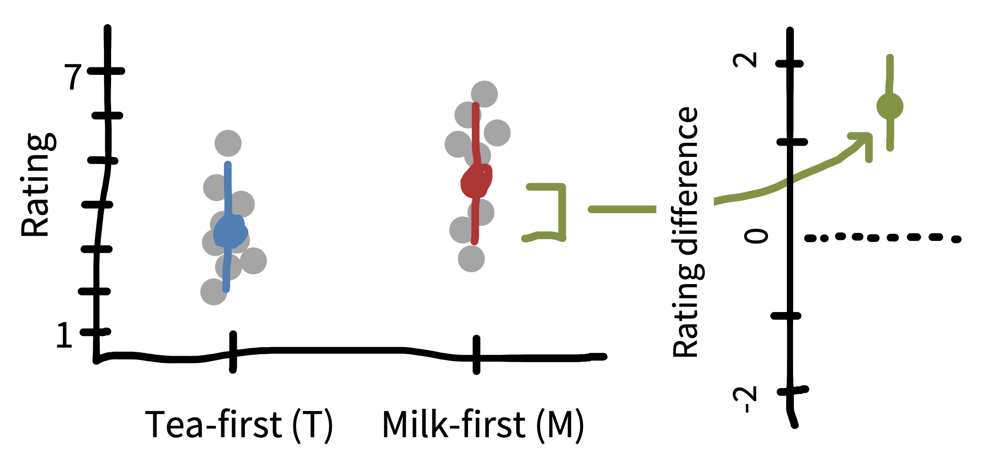{.nostretch height=260 fig-alt="Condition means for tea-first and milk-first with confidence intervals, and the difference between conditions with its confidence interval."}

- $\widehat{\beta} \pm 1.96$ standard errors
- Out of 100 experiments, about 95 of the intervals contain the true $\beta$.
- Here, an interval that excludes zero means a significant *t*-test.

## Confidence in confidence intervals?

"The 95% confidence interval for the mean ranges from 0.1 to 0.4."

Which of these are true?

1. There is a 95% probability that the true mean lies between 0.1 and 0.4.
2. We can be 95% confident that the true mean lies between 0.1 and 0.4.
3. The probability that the true mean equals 0 is smaller than 5%.

## What we can say

None of them is true.

If we repeated the experiment many times, 95% of the intervals we compute would contain the true value.
