## What did earlier studies ask?

**Which words are hard to name? What kinds of errors occur?**

- **Frequency and age of acquisition:** mixed findings on whether errors are more frequent or earlier learned than targets.
- **Typicality:** people with semantic dementia often substitute a more typical category member (Woollams et al., 2008; Woollams, 2012).
- **Semantic features:** words with more features can be named faster and more accurately (Taylor et al., 2012; Rabovsky et al., 2016).

::: {.prompt}
But why say *pelican*, rather than *peacock*, for *flamingo*?
:::

::: footer
Earlier literature as reviewed in Lampe et al. 2024, pp. 19 to 22
:::

## What can a wrong word tell us?

Someone sees **flamingo** but says **pelican**.

- **The activation account:** the representation of *pelican* became more strongly activated in the mental lexicon than the representation of *flamingo*.
- **The question:** which properties of the words, and of their relationship, could explain that activation pattern?
- **The approach:** compare targets and errors on psycholinguistic variables such as typicality, number of semantic features, and similarity.

::: {.claim}
Patterns in naming errors can help us infer how word knowledge is represented and activated during production.
:::

::: footer
Lampe et al. 2024
:::

## Task: speeded picture naming

**Show a picture → require a fast name → collect the mistakes.**

- A short response deadline produces more naming errors in neurotypical speakers.
- **Mirman (2011):** errors often came from the target's **near semantic neighbours**, more often than chance would predict.
- **Lampe et al.'s next question:** among possible wrong words, which semantic properties favour selection?

::: {.claim}
Being related to the target may get a word activated. What makes it win?
:::

::: footer
Moses et al. 2004; Mirman 2011, as reviewed in Lampe et al. 2024, pp. 18 to 22
:::

## Earlier evidence: neighbourhood effects {#mirman-evidence}

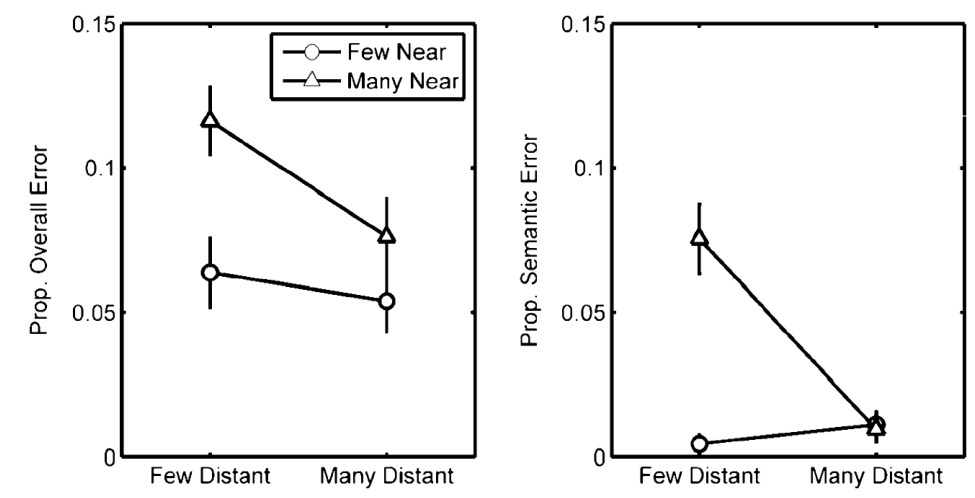{.nostretch .scientific-plot height=350 fig-alt="Mirman 2011 Figure 3: overall and semantic error proportions by few versus many near and distant semantic neighbours in speeded controls."}

**More near neighbours:** more errors. **More distant neighbours:** fewer errors overall.

::: footer
[Mirman 2011, Figure 3, p. 39](https://doi.org/10.3758/s13415-010-0009-7), original plot
:::

## The logic: compare each error with its target {.smaller}

Related words become active together. An error shows which alternative was selected.

| Property | Comparison | Prediction |
|---|---|---|
| **Typicality** | How representative is the error of its category, relative to the target? | Error > target |
| **Number of features** | How many semantic properties does each word have? | Error > target |
| **Semantic similarity** | Is the error closer to the target than the target's near neighbours are, on average? | Error similarity > neighbour average |

Account for frequency, age of acquisition, familiarity, word length, imageability, and naming history.

::: footer
Lampe et al. 2024, pp. 22 to 23, 26 to 27
:::

## Materials

- **78 participants** analysed: native Australian English speakers.
- **297 colour photographs** of objects, with high name agreement (>75%).
- **McRae et al. (2005) norms:** semantic features for calculating all three measures.
- Six presentation lists; at least two other-category pictures between pictures from the same category.

**Compare real-word errors with known target names.** Both words need the relevant norm data.

::: footer
Lampe et al. 2024, pp. 22 to 26
:::

## Procedure: start speaking within 600 ms

**First:** standard naming. Then standard and speeded naming, in counterbalanced order.

**Practice:** picture + beep at 600 ms. Try to beat the beep.

**Experimental trial:**

::: {.claim}
Fixation (500 to 1000 ms) → picture (2000 ms, no beep) → speed feedback (400 ms) → blank (1000 ms)
:::

Say the first word that comes to mind. **Prioritize speed over accuracy.**

::: footer
Lampe et al. 2024, p. 24
:::


## Pictures {#naming-preview .naming-preview data-autoslide=0}

```{=html}
<div class="naming-preview-grid">
  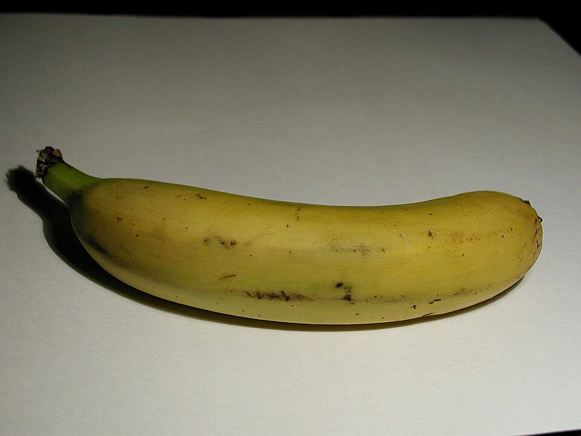
  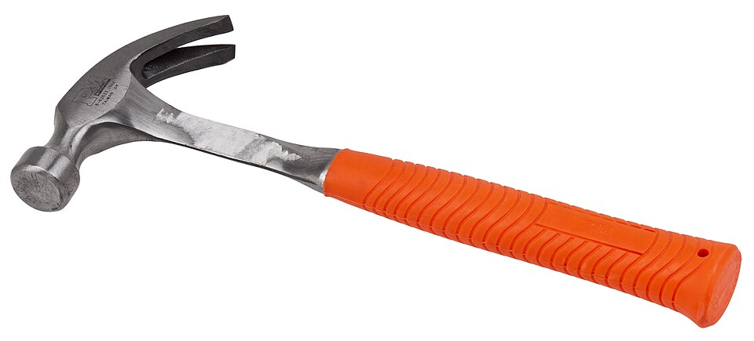
  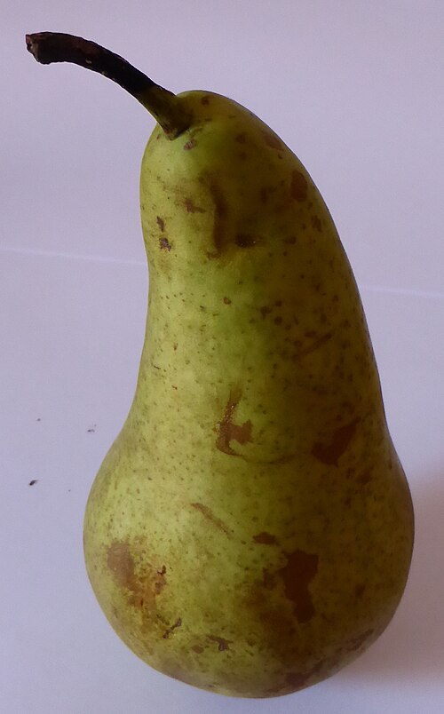
  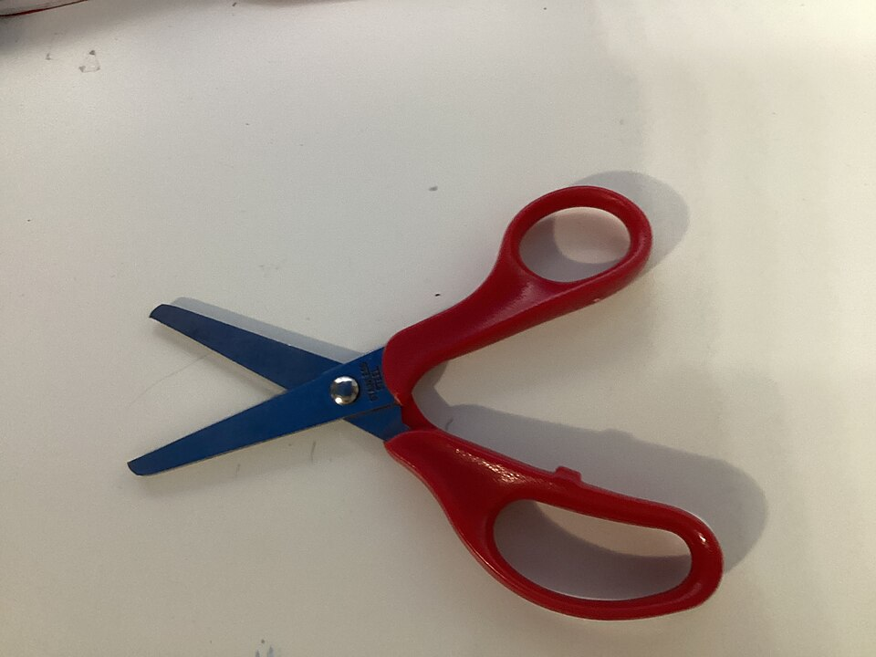
  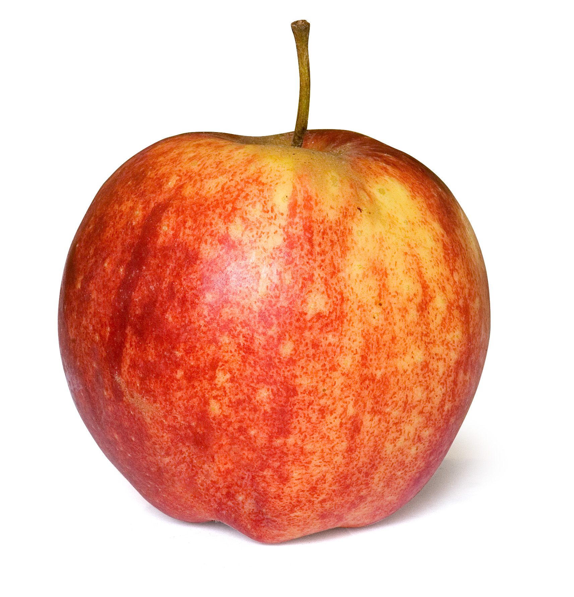
  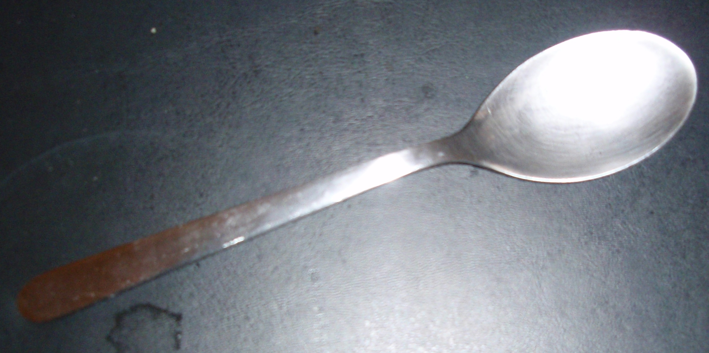
  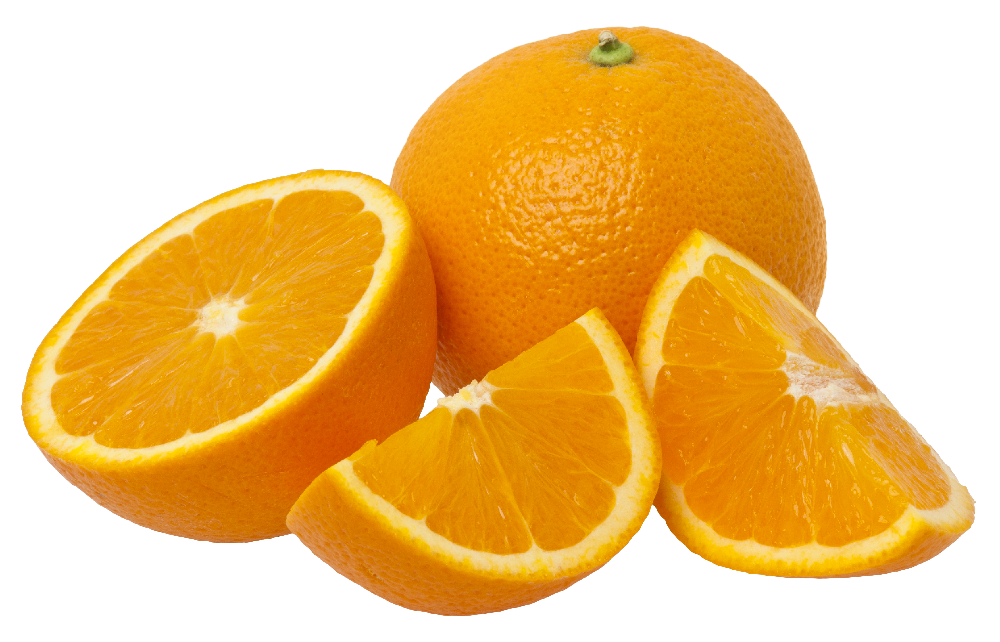
  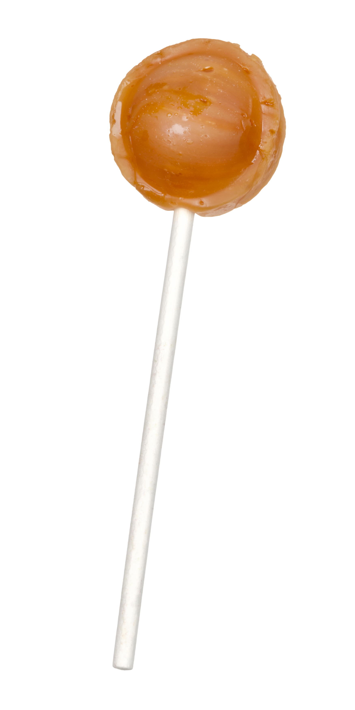
</div>
```

## Try it: name the pictures {#naming-start data-autoslide=0}

**Say the first name that comes to mind, out loud.**

- Look at the **+** before each picture.
- Begin speaking before the picture disappears: **600 ms**.
- Keep going if you make a mistake. There are **eight pictures**.

```{=html}
<button class="naming-button" type="button" data-naming-start disabled>Start naming</button>
<p id="naming-status" class="naming-status" role="status">Loading pictures...</p>
<noscript>This timed demonstration needs JavaScript.</noscript>
```

## Fixation 1 {#naming-fixation-1 .naming-trial data-autoslide=750}

::: {.naming-stage .naming-fixation}
\+
:::

## Picture 1 {#naming-picture-1 .naming-trial data-autoslide=600}

::: {.naming-stage}
{fig-alt="Banana" loading="eager"}
:::

## Blank 1 {#naming-blank-1 .naming-trial data-autoslide=1000}

::: {.naming-stage}
&nbsp;
:::

## Fixation 2 {#naming-fixation-2 .naming-trial data-autoslide=750}

::: {.naming-stage .naming-fixation}
\+
:::

## Picture 2 {#naming-picture-2 .naming-trial data-autoslide=600}

::: {.naming-stage}
{fig-alt="Hammer" loading="eager"}
:::

## Blank 2 {#naming-blank-2 .naming-trial data-autoslide=1000}

::: {.naming-stage}
&nbsp;
:::

## Fixation 3 {#naming-fixation-3 .naming-trial data-autoslide=750}

::: {.naming-stage .naming-fixation}
\+
:::

## Picture 3 {#naming-picture-3 .naming-trial data-autoslide=600}

::: {.naming-stage}
{fig-alt="Pear" loading="eager"}
:::

## Blank 3 {#naming-blank-3 .naming-trial data-autoslide=1000}

::: {.naming-stage}
&nbsp;
:::

## Fixation 4 {#naming-fixation-4 .naming-trial data-autoslide=750}

::: {.naming-stage .naming-fixation}
\+
:::

## Picture 4 {#naming-picture-4 .naming-trial data-autoslide=600}

::: {.naming-stage}
{fig-alt="Scissors" loading="eager"}
:::

## Blank 4 {#naming-blank-4 .naming-trial data-autoslide=1000}

::: {.naming-stage}
&nbsp;
:::

## Fixation 5 {#naming-fixation-5 .naming-trial data-autoslide=750}

::: {.naming-stage .naming-fixation}
\+
:::

## Picture 5 {#naming-picture-5 .naming-trial data-autoslide=600}

::: {.naming-stage}
{fig-alt="Apple" loading="eager"}
:::

## Blank 5 {#naming-blank-5 .naming-trial data-autoslide=1000}

::: {.naming-stage}
&nbsp;
:::

## Fixation 6 {#naming-fixation-6 .naming-trial data-autoslide=750}

::: {.naming-stage .naming-fixation}
\+
:::

## Picture 6 {#naming-picture-6 .naming-trial data-autoslide=600}

::: {.naming-stage}
{fig-alt="Spoon" loading="eager"}
:::

## Blank 6 {#naming-blank-6 .naming-trial data-autoslide=1000}

::: {.naming-stage}
&nbsp;
:::

## Fixation 7 {#naming-fixation-7 .naming-trial data-autoslide=750}

::: {.naming-stage .naming-fixation}
\+
:::

## Picture 7 {#naming-picture-7 .naming-trial data-autoslide=600}

::: {.naming-stage}
{fig-alt="Orange" loading="eager"}
:::

## Blank 7 {#naming-blank-7 .naming-trial data-autoslide=1000}

::: {.naming-stage}
&nbsp;
:::

## Fixation 8 {#naming-fixation-8 .naming-trial data-autoslide=750}

::: {.naming-stage .naming-fixation}
\+
:::

## Picture 8 {#naming-picture-8 .naming-trial data-autoslide=600}

::: {.naming-stage}
{fig-alt="Lollipop" loading="eager"}
:::

## Blank 8 {#naming-blank-8 .naming-trial data-autoslide=1000}

::: {.naming-stage}
&nbsp;
:::

## What happened under time pressure? {#naming-finished data-autoslide=0}

```{=html}
<button class="naming-button" type="button" data-naming-start disabled>Replay the eight pictures</button>
```


## Picture exposure and response deadline {#trial-timing}

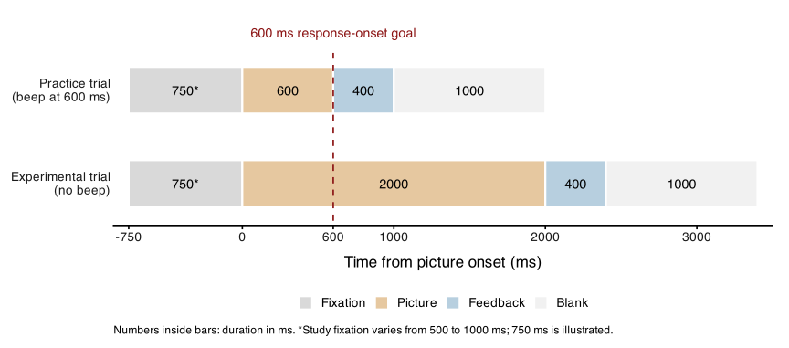{.nostretch .scientific-plot height=440 fig-alt="Trial timelines: practice uses a 600 ms picture and 400 ms feedback; experimental trials use a 2000 ms picture and 400 ms feedback. Both have a 600 ms response goal and 1000 ms blank."}

::: footer
Diagram from Lampe et al. 2024, p. 24
:::

## Can we know the answer from this experiment?


## Results: Table 1 {#lampe-table1 .error-table}

| Broad category | Error type | Count | % of errors |
|---|---|---:|---:|
| Semantic errors | Coordinate | 1,677 | 85.30 |
| | Semantic other | 92 | 4.68 |
| | Part-whole relationship | 23 | 1.17 |
| | Associate | 8 | 0.41 |
| | Superordinate | 3 | 0.15 |
| Other errors | Unrelated | 111 | 5.65 |
| | Visual | 29 | 1.48 |
| | Phonologically related word | 22 | 1.12 |
| | Compound | 1 | 0.05 |
| | **Total** | **1,966** | **100.00** |

::: footer
Lampe et al. 2024, Table 1, p. 28; errors included in the primary analyses
:::

## What did they find? {.smaller}

**1,966 errors** in the primary analysis; **85.3%** were same-category substitutions.

| Prediction | Result |
|---|---|
| More typical than the target | **Supported:** adjusted difference +2.52, p < .01 |
| More semantic features than the target | **Supported:** +0.61 features, p < .05 |
| Closer than the near-neighbour average | **Not supported:** similarity difference −0.06, p < .001 |

Errors were often near neighbours, but **not systematically closer than the average near neighbour**.

<!-- ::: {.claim}
Meaning matters beyond similarity alone. These patterns do not decide whether lexical selection is competitive.
::: -->

::: footer
Lampe et al. 2024, pp. 28 to 30, 33 to 35; Tables 1 and 2
:::


## The distributions: typicality and features {#lampe-distributions}

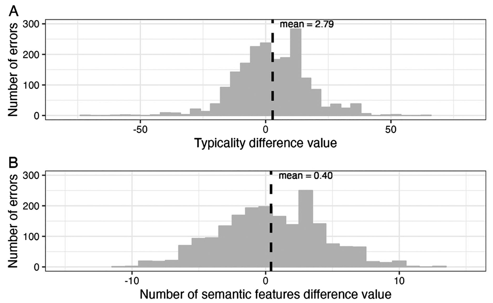{.nostretch .scientific-plot height=440 fig-alt="Lampe Figure 1 panels A and B: histograms of error minus target typicality and feature count. Raw mean differences are 2.79 and 0.40, with wide variation on both sides of zero."}

::: footer
[Lampe et al. 2024, Figure 1A and 1B, p. 29](https://doi.org/10.1080/02643294.2024.2315822), original panels
:::

## Similarity: what is the comparison? {#lampe-similarity}

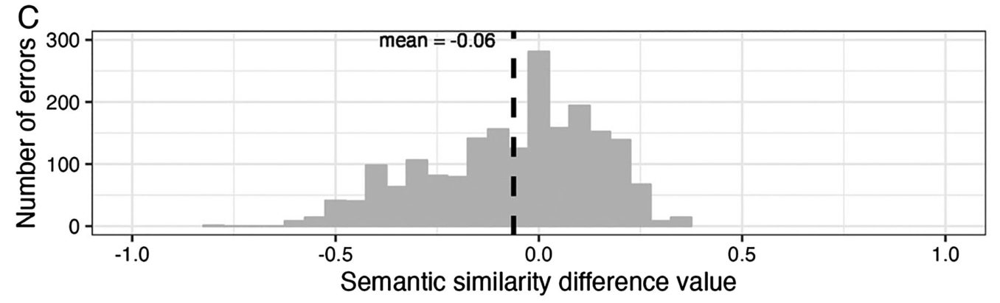{width=90% fig-alt="Lampe Figure 1C: histogram of target-error similarity minus the target's average near-neighbour similarity. The raw mean difference is minus 0.06."}

**Zero:** the error is as similar to the target as the average near neighbour is.

**Below zero:** the error is less similar than that average.

::: footer
[Lampe et al. 2024, Figure 1C, p. 29](https://doi.org/10.1080/02643294.2024.2315822), original panel
:::
<!--
## The adjusted estimates {#lampe-estimates}

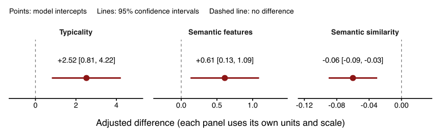{width=100% fig-alt="Primary-analysis intercepts and 95 percent confidence intervals: typicality 2.52, 0.81 to 4.22; feature count 0.61, 0.13 to 1.09; similarity minus 0.06, minus 0.09 to minus 0.03."}

- **Typicality and features:** error minus target.
- **Similarity:** target-error similarity minus the target's near-neighbour average.

::: footer
Plotted from Lampe et al. 2024, p. 28; primary analyses, 1,966 errors
:::
-->

## Naming demo: image credits {.naming-credits data-autoslide=0}

Photographs from Wikimedia Commons, saved locally. Originals or Commons thumbnails; no content edits.

| Picture and source | Creator | License |
|---|---|---|
| [Banana](https://commons.wikimedia.org/wiki/File:Banana_on_white_background.jpg) | Paolo Neo | Public domain |
| [Hammer](https://commons.wikimedia.org/wiki/File:Claw-hammer.jpg) | Evan-Amos | Public domain |
| [Pear](https://commons.wikimedia.org/wiki/File:Pear-2.jpg) | MartinThoma | [CC0 1.0](https://creativecommons.org/publicdomain/zero/1.0/) |
| [Scissors](https://commons.wikimedia.org/wiki/File:Pair_of_scissors_on_white_background.jpg) | Help e choose | [CC BY-SA 4.0](https://creativecommons.org/licenses/by-sa/4.0/) |
| [Apple](https://commons.wikimedia.org/wiki/File:Apple-003.jpg) | Amada44 | Public domain |
| [Spoon](https://commons.wikimedia.org/wiki/File:Spoon.JPG) | Ari Abitbol | Public domain |
| [Orange](https://commons.wikimedia.org/wiki/File:Orange-Fruit-Pieces.jpg) | Evan-Amos | [CC BY-SA 3.0](https://creativecommons.org/licenses/by-sa/3.0/) |
| [Lollipop](https://commons.wikimedia.org/wiki/File:Tootsie-Roll-Pop-Orange.jpg) | Evan-Amos | Public domain |

## Appendix: how are the measures calculated? {.smaller}

Start with features people listed for each word, such as **has wings** or **flies** (McRae et al., 2005).

- **Typicality:** for each feature, multiply the proportion of category members sharing it by the number of people who listed it for that word, then add the scores. Shared, often-mentioned features give higher typicality.
- **Number of features:** count the different listed properties, excluding category labels such as *is a bird*.
- **Semantic similarity:** compare two words' feature profiles using **cosine similarity**. More overlap gives a higher score.

::: footer
Lampe et al. 2024, p. 23; measures based on McRae et al. 2005
:::
