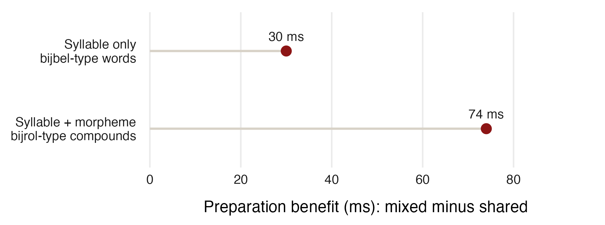

## The conditions: cue, response, shared part {.smaller}

Each row is a **three-pair block**. Learn cue → response; then see only the cue
and say its response.

| Cue | Response | Condition name | Shared |
|---|---|---|---|
| **religie** haast spoor | **bijbel** bijna bijster | Syllable: shared | Initial syllable **bij** |
| **religie** brein dicht | **bijbel** hersens nader | Syllable: mixed | No common beginning |
| studie **toneel** long | bijvak **bijrol** bijnier | Morpheme: shared | Initial morpheme **bij** |
| **toneel** steiger mond | **bijrol** herbouw nasmaak | Morpheme: mixed | No common beginning |

**religie → bijbel:** religion → bible  
**toneel → bijrol:** stage → supporting role

::: footer
Actual materials: Roelofs 1996, Experiment 1, Table 1, p. 862; example blocks
:::

## Read the result

{width=90% fig-alt="Observed preparation benefits: 30 ms for initial syllable overlap in bijbel-type words and 74 ms for initial morpheme overlap in bijrol-type compounds."}

**Higher = more time saved.** Both groups benefit; the compound group benefits more.

::: {.prompt}
Both groups share the sounds *bij*. What could explain the extra benefit?
:::

::: footer
Roelofs 1996, Experiment 1, Table 2, p. 863; reviewed in Roelofs 2000, pp. 98 to 99
:::

## What must a model explain?

- **Units:** preparing a morpheme saves more time than preparing its sounds alone.
- **Order:** in further experiments, a shared later morpheme, such as **rol**
  in *bijrol*, gave **no preparation benefit**.

::: {.prompt}
What can be completed before the cue, and why must preparation start at the beginning?
:::

::: footer
Roelofs 2000, pp. 98 to 99
:::

## WEAVER++: select, then encode

**Concept → lemma + features → morphemes → sounds → speech**

- A **lemma** supplies grammatical information; normally, only the selected
  lemma starts form encoding.
- **Verification** checks that a candidate belongs to the selected word.
  Activation affects how long selection takes.
- **Rightward incrementality:** build the sound plan from the beginning,
  pause, then resume when more is known.

**For *bijrol*:** prepare the morpheme *bij* and its syllable.  
**For *bijbel*:** prepare the syllable only.

::: footer
Roelofs 2000, pp. 83 to 87, 93 to 98; simplified production sequence
:::

## Dell: activation with feedback

**Conceptual features ↔ lemmas ↔ morphemes ↔ sounds**

- Activation spreads down **and back up**; shared sounds can support a word.
- At scheduled selection times, the most active eligible unit fills a slot.
- This helps explain **mixed errors**: *rat* for *cat* shares meaning and sounds.

::: footer
Roelofs 2000, pp. 76 to 81; classical Dell model, simplified
:::

## Same units, different selection mechanisms

| | Classical Dell | WEAVER++ |
|---|---|---|
| Sounds feed back to word selection? | Yes | No |
| Selection | Most active eligible unit at a scheduled time | Activation plus verification; time varies |
| Main evidence explained | Speech-error patterns | Production-time patterns |

::: {.prompt}
Which mechanism explains why advance preparation changes response time?
:::

::: footer
Roelofs 2000, pp. 80 to 87, 98; comparison of the versions reviewed here
:::

## Your Questions

## Try it: prepare a grammatical form {.demo}

[Open the experiment](../implicit-priming.qmd) · Choose **Grammar**

See **GO** and “Yesterday, I ___ home.” Say only **went**.

| Condition | Example responses | Shared |
|---|---|---|
| Same grammatical context | went, ate, bought | Simple past; no common affix |
| Mixed grammatical contexts | went, eat, bought | Past, habitual present, present perfect |

## Was it easier to stay in one grammatical context?

In a shared past-tense block, you knew **past tense** before seeing the verb.
The responses *went, ate, bought* share no common affix.

::: {.prompt}
Did switching grammatical contexts make it harder to get ready?
:::

**Model question:** can we prepare grammatical information before its word form?
