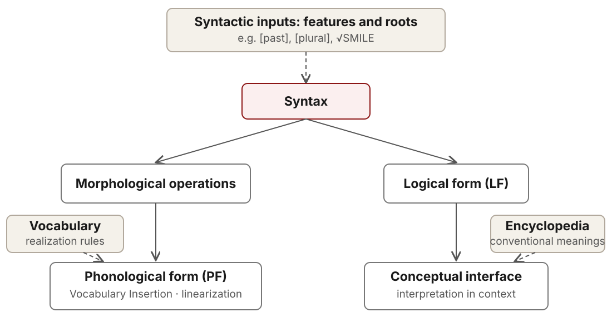

## What are we preparing when we prepare a word?

Last week: speakers can prepare **morphological pieces**, as well as sounds.

Today: what are those pieces, and how do they become a spoken word?

::: {.prompt}
Compare **smile**, **smiles**, and **smiled**. What stays the same? What changes?
:::

## A first pass: meaningful pieces

| Word | A first segmentation | Contributions |
|---|---|---|
| dogs | dog-s | dog + plural |
| unkind | un-kind | negation + kind |
| workers | work-er-s | work + person who does it + plural |

A **morpheme**, in a familiar introductory definition, is a minimal pairing
of form with meaning or grammatical function.

## Root, base, affix

**work → worker → workers**

| Term | What it identifies | Here |
|---|---|---|
| **Root** | The core left after removing affixes | work |
| **Base** | What an affix attaches to | work for -er; worker for -s |
| **Affix** | A bound piece attached to a base | -er, -s |

A base can already contain several morphemes.

## Ambiguities in words

**unlockable** can have two bracketings:

| Structure | Interpretation |
|---|---|
| [un-[lock-able]] | Not able to be locked |
| [[un-lock]-able] | Able to be unlocked |

Same linear pieces; different combinations and meanings.

## Free/bound and lexical/functional {.smaller}

These answer **different questions**.

| | Lexical content | Grammatical function |
|---|---|---|
| **Free:** can occur as a word | dog, kind | the, and |
| **Bound:** needs a host | cran- in cranberry | plural -s, past -ed |

**Free/bound:** how dependent is its form?  
**Lexical/functional:** what kind of contribution does it make?

::: {.prompt}
Why isn't “root” another word for “free morpheme”?
:::

## Affixes can go in different places {.smaller}

| Pattern | Position | Example |
|---|---|---|
| **Prefix** | Before a base | un-kind |
| **Suffix** | After a base | kind-ness |
| **Infix** | Inside a base | Tagalog s-um-ulat, from sulat ‘write’ |
| **Circumfix pattern** | Around a base | German ge-spiel-t ‘played’, participle |

Position describes **where the material appears**.

## Derivation and inflection

| | Typical job | Example |
|---|---|---|
| **Derivation** | Make a new lexeme | kind → kindness; kind → unkind |
| **Inflection** | Make a grammatical form of a lexeme | dog → dogs; smile → smiled |

Derivation **can** change word class; *unkind* shows that it need not.

Inflection contributes meaning too: **past** and **plural** matter.

## Try the distinctions

**unhappiness** · **replayed** · **doghouses**

For each word:

1. Identify roots and affixes.
2. Identify a base that contains more than one morpheme.
3. Separate derivation, inflection, and compounding.

::: {.prompt}
Which labels describe position, and which describe function?
:::

## One function, several pronunciations

| Plural form | Ending we hear |
|---|---|
| cats | [s] |
| dogs | [z] |
| buses | [ɪz] or [əz] |

These are **allomorphs**: different realizations of a morpheme.

Here, the surrounding **sounds** predict the variation.

## Grammatical pieces needn't be sound segments

| Contrast | What changes in the form? |
|---|---|
| cat → cats | Add an ending |
| sheep → sheep | No audible change |
| mouse → mice | Change the stem vowel |
| go → went | Use a radically different stem: **suppletion** |

::: {.claim}
We can identify a grammatical contrast without finding a separate sound
segment for it.
:::

## One ending can express several features

**She walk-s.**

The ending occurs with a bundle of properties:

**present tense + third person + singular**

Compare **I walk**, **they walk**, **she walked**.

::: {.prompt}
Where are the three separate sound pieces for those three properties?
:::

## What should a theory explain?

- **Combination:** how do the pieces form a structure?
- **Realization:** how does that structure receive a pronunciation?
- **Interpretation:** how does it receive a meaning?

::: {.claim}
DM separates these jobs and locates them in different parts of the grammar.
:::

## Where are words built?

| A lexicalist architecture | Distributed Morphology |
|---|---|
| A word-building component supplies words to syntax. | Syntax builds structures within words as well as phrases. |
| Word formation and phrase formation have distinct machinery. | One syntactic system combines the abstract building blocks. |

**DM:** pronunciation is supplied after syntactic combination.

## “Morpheme” now means something more abstract

| First-pass definition | In the DM analysis |
|---|---|
| A minimal form–function pairing | A terminal node with grammatical content, or a root |
| Plural looks like a piece **-s** | Syntax contains **Number[plural]** |
| Its sound and function come together | A realization rule supplies its **exponent** |

**Exponent** = the form that realizes a grammatical unit.

## A map of the grammar

{width=94% height=470px fig-alt="Syntactic features and roots feed syntax. Syntax branches toward morphological operations and phonological form on the left, and logical form and the conceptual interface on the right. Vocabulary Items feed phonological form; the Encyclopedia feeds the conceptual interface."}

## What is distributed? {.smaller}

| Store | Stored information | Used for |
|---|---|---|
| **Syntactic inputs** | Features and roots, e.g. [past], √SMILE | Building structure |
| **Vocabulary** | Rules linking roots/features to exponents | Pronunciation |
| **Encyclopedia** | Conventional meanings and world knowledge | Interpretation in context |

There is stored knowledge, spread across these lists.

## A variation in the reading

The usual three-store presentation groups **features and roots** together.

**Goryczka (2025)** separates them into two input lists, giving four lists
in total.

The central distinction remains:

**syntactic inputs** · **pronunciations** · **conventional meanings**

## Build a word: *smiled*

**1. Select abstract ingredients**

**√SMILE** + **v** + **T[past]**

**2. Combine them hierarchically**

\[
\bigl[\mathrm{T}_{\text{past}}\;\bigl[\mathrm{v}\;\sqrt{\mathrm{SMILE}}\bigr]\bigr]
\]

**v** makes a verbal structure; **T** contributes tense.

## Give the structure a pronunciation

**3. Vocabulary Insertion supplies exponents**

| Abstract item | Exponent in this example |
|---|---|
| √SMILE | /smaɪl/ |
| v | ∅ |
| T[past] | /d/ |

**4. Arrange the pieces and apply phonology:** [smaɪld], *smiled*.

## Meanwhile, the structure is interpreted

**LF:** combine the structural contributions, including past tense.

**Conceptual interface:** use conventional meaning and world knowledge.

For *smiled*: a smiling event located in the past.

::: {.claim}
The root label, its pronunciation, and its interpretation have different
jobs in the analysis.
:::

## How does the grammar choose an exponent?

A simplified plural Vocabulary:

| Realization rule | Condition |
|---|---|
| Number[plural] ↔ ∅ | In the local context of √SHEEP |
| Number[plural] ↔ /z/ | Elsewhere |

**two sheep:** the specific rule applies.  
**two dogs:** use the elsewhere rule.

## Underspecification: a rule can say less {.smaller}

**I smiled. She smiled. They smiled.**

The subjects differ in person and number; the past ending stays **/d/**.

A rule **T[past] ↔ /d/** need not specify person or number.

- Its requirements must be present in the node.
- It must not require a conflicting feature.
- A more specific eligible competitor can block it.

**The rule can be underspecified even when the structure is fully specified.**

## Why leave room for morphological operations?

Syntax and pronunciation may package features differently.

- **Fusion:** combine terminal nodes for realization.
- **Fission:** split a node or its realization across more than one piece.
- **Impoverishment:** remove a feature on the pronunciation branch.

These operations occur **after syntax**, toward PF.

## Your turn: *record*

Keep a **record** of the meeting.

Please **record** the meeting.

::: {.prompt}
How would DM derive these two uses of *record*, using its different lists?
:::

## Your turn: *separate*

The files are **separate**.

Please **separate** the files.

::: {.prompt}
How would DM derive these two uses of *separate*, using its different lists?
:::

## Your turn: nominalizations

**arrive → arrival**

**collect → collection**

**destroy → destruction**

::: {.prompt}
How would DM derive these nouns? What must be listed, and what must the
morphology or phonology do?
:::

## Back to language production

| A possible error pattern | Candidate source of difficulty |
|---|---|
| Wrong root, intended tense retained | Root selection or realization |
| Intended root, wrong tense form | Feature selection or grammatical realization |

Root and inflection errors can help us investigate these distinctions.

::: {.prompt}
What additional evidence would distinguish a feature error from an
exponent-selection error?
:::

## Exit ticket

1. Classify **-s** in *dogs* by position and grammatical function.
2. Explain how **REcord** and **reCORD** can share a root but differ in
   category and pronunciation.
3. Trace *smiled* through the DM architecture: where do structure,
   pronunciation, and interpretation come from?

## Foundations and further reading {.smaller}

- **Halle & Marantz (1993).** [“Distributed Morphology and the Pieces of Inflection.”](https://web.mit.edu/morrishalle/pubworks/papers/1993_Halle_Marantz_Hale_Keyser_Distributed_Morphology_Pieces_of_Inflection.pdf)
- **Marantz (1997).** [“No Escape from Syntax: Don't Try Morphological Analysis in the Privacy of Your Own Lexicon.”](https://repository.upenn.edu/pwpl/vol4/iss2/14/)
- **Harley & Noyer (1999).** [“State-of-the-Article: Distributed Morphology.”](https://dingo.sbs.arizona.edu/~hharley/PDFs/HarleyNoyerDM1999.pdf)
- **Bobaljik (2017).** “Distributed Morphology.”

## Thank you

Thank you to **Faruk Akkuş** and **Pamela Goryczka** for the materials
that helped shape these slides.
