## First, an ordinary DM tree

**cats**: a root, a nominal categorizer, and plural Number.

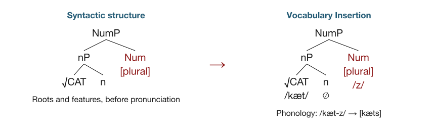{.dm-tree fig-alt="Before insertion, NumP contains nP with root CAT and n, plus Num plural. After insertion the same nodes receive kæt, zero, and z. Phonology yields cats."}

The hierarchy stays the same here. Pronunciation is supplied at PF.

## Why leave room for morphological operations?

Syntax and pronunciation may package features differently.

| Operation | What changes on the PF branch? |
|---|---|
| **Fusion** | Two terminals become one insertion site. |
| **Fission** | One terminal supports more than one insertion site. |
| **Impoverishment** | A feature is deleted before insertion. |

## Fusion: two terminals, one insertion site

Italian **am-a-te**, ‘you.PL love’, present indicative.

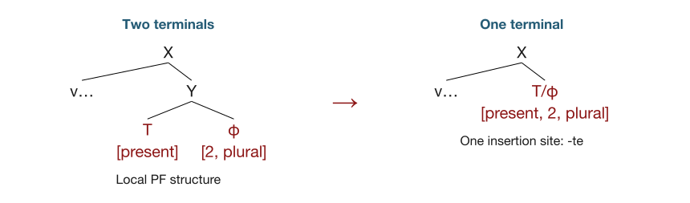{.dm-tree fig-alt="A local PF subtree with separate T present and phi second-person plural becomes a subtree with a single T/phi terminal carrying present, second person, and plural."}

The features survive; their **packaging** changes.

## Fission: one terminal, two insertion sites

**Toy paradigm:** one agreement bundle, two endings.

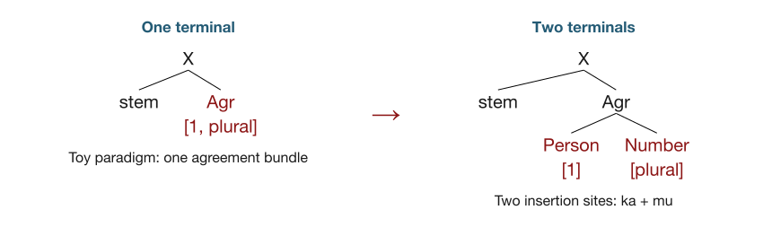{.dm-tree fig-alt="Agr first-person plural under X splits into Person first and Number plural, realized separately as ka and mu. This is an invented paradigm."}

**ka** ↔ [1st person] · **mu** ↔ [plural] → **stem-ka-mu**

## Impoverishment: fewer features at PF

Spanish **le dio un libro**, ‘gave her a book’, but **se lo dio**, ‘gave it to her’.

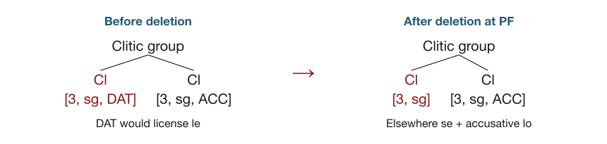{.dm-tree fig-alt="In a simplified Spanish clitic analysis, DAT is removed from the first clitic before an accusative clitic. Both nodes remain, but the first no longer licenses le; se appears instead."}

Delete **[DAT]** before an accusative clitic → **se lo**, not **\*le lo**.

## What changed?

| | Terminal sites | Features at PF |
|---|---|---|
| Ordinary insertion | Same | Same |
| Fusion | Fewer | Combined |
| Fission, as drawn | More | Distributed across sites |
| Impoverishment | Same in our example | Reduced |

## Your turn: *record*

Keep a **record** of the meeting.

Please **record** the meeting.

1. Draw a syntactic tree for each use in DM.
2. State what is shared and what differs in the two structures.
3. Propose a rule for the pronunciation in each context, including stress.

## An answer: *record*

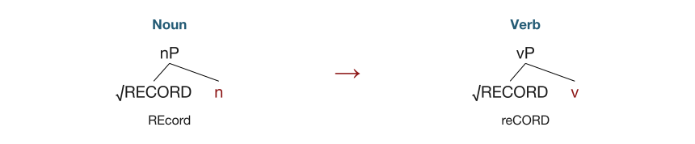{.dm-tree fig-alt="Root RECORD combines with n in the noun and v in the verb. The noun has initial stress; the verb has final stress."}

For **√RECORD**:

- In an **n** context, stress the first syllable: **REcord**.
- In a **v** context, stress the second syllable: **reCORD**.

The vowels also differ: /ˈrɛkɚd/ versus /rɪˈkɔɹd/.

## Your turn: *separate*

The files are **separate**.

Please **separate** the files.

1. Draw a syntactic tree for each use in DM.
2. Identify the shared root and the different categorizing heads.
3. Propose a pronunciation rule for the final syllable. Does stress change?

## An answer: *separate*

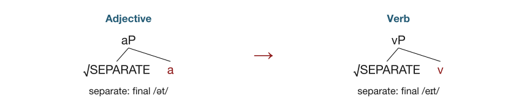{.dm-tree fig-alt="Root SEPARATE combines with a in the adjective and v in the verb. The adjective ends in schwa-t; the verb ends in ay-t."}

For **√SEPARATE**:

- In an **a** context, realize the ending as **/ət/**.
- In a **v** context, realize the ending as **/eɪt/**.

Both forms retain **initial primary stress**.

## Your turn: nominalizations

**arrive → arrival**

**collect → collection**

**destroy → destruction**

1. Draw a DM tree for each noun.
2. State a rule choosing the nominal suffix in each context.
3. Explain any changes needed in the stem or its pronunciation.

## An answer: nominalizations

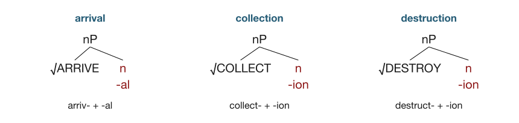{.dm-tree .compact-tree fig-alt="Nominal heads combine with ARRIVE, COLLECT, and DESTROY. Their suffixes are al, ion, and ion; DESTROY uses the stem destruct-."}

- **n → -al** with √ARRIVE; **n → -ion** with √COLLECT and √DESTROY.
- **√DESTROY → destruct-** in this nominal context.
- Stem-suffix phonology gives **collection** /kəˈlɛkʃən/ and
  **destruction** /dɪˈstrʌkʃən/.

## Why connect DM to production?

Both accounts distinguish **building a grammatical representation** from
**giving it a pronunciation**.

| Production question | DM's resources |
|---|---|
| What gets selected? | Roots and grammatical features |
| How does it combine? | Syntax and morphological operations |
| How does it sound? | Vocabulary Insertion and phonology |

## DM inside the Formulator

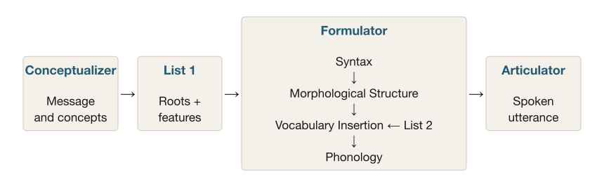{.dm-tree fig-alt="Conceptualizer activates roots and features in List 1. These feed the Formulator: syntax, Morphological Structure, Vocabulary Insertion using List 2, and phonology. The output passes to the Articulator."}

**DM supplies the Formulator's grammatical machinery.**

## What changes from a lemma-based account?

| A familiar production account | A DM production account |
|---|---|
| Select a lemma with grammatical properties. | Select an abstract root and grammatical features. |
| Use lexical information to build the utterance. | Combine roots with functional structure. |
| Retrieve the phonological form. | Insert exponents into the resulting structure. |

A **root** does not already contain its final category and inflected form.

## Late pronunciation still needs early root identity

Selecting **√KATZ** ‘cat’ is different from selecting a generic **ROOT** slot.

- The intended concept activates a particular root.
- Syntax combines that root with grammatical structure.
- Vocabulary Insertion supplies the appropriate pronunciation.

## 1. Start with the message

We want to say: **Die Katzen schnurren.**  
‘The cats are purring.’

- We are talking about **cats**.
- There is **more than one**.
- The listener can identify **which cats**.
- They are **purring now**.

## 2. Select roots and grammatical features

| Contribution from the message | Input to grammatical encoding |
|---|---|
| Cats; purring | **√KATZ**, **√SCHNURR** |
| More than one cat | **[plural]**, associated with √KATZ |
| Identifiable referents | **D[definite]** |
| Present time in this example | **T[−past]** |

These are abstract inputs. Their pronunciations have not been inserted.

## 3. Build the nominal structure

Combine **√KATZ** with the nominal categorizer **n**.

{.dm-tree fig-alt="Root KATZ combines with n, highlighted in red, to form nP."}

The result is **nP**: a root in a nominal context.

## 4. Add plural Number

Combine the nominal structure with **Num[plural]**.

{.dm-tree fig-alt="Num plural is added above the existing nP containing root KATZ and n."}

The structure now refers to multiple cats. **[plural]** is still a feature.

## 5. Add definiteness

Combine **D[definite]** with the plural nominal structure.

{.dm-tree fig-alt="D definite is added above the existing NumP, creating a DP for the identifiable plural cats."}

This **DP** identifies the cats the speaker is talking about.

## 6. Build the predicate and add its subject

Combine **√SCHNURR** with **v**, and place the cats' DP in the subject position.

{.dm-tree fig-alt="A vP contains the already built subject DP and a verbal structure made from root SCHNURR and v. A triangle abbreviates the subject's internal structure."}

The structure connects **who is purring** with **the purring event**.

## 7. Add tense

Combine the predicate with **T[−past]**, appropriate to the present-time message.

{.dm-tree fig-alt="T minus past is added above the vP containing the subject DP and the purring predicate. T appears to the right before movement."}

The clause now contains both the event and its temporal specification.

## 8. Establish the main-clause order

The verbal head raises through **v → T → C**. The subject DP moves to the front.

{.dm-tree fig-alt="In the resulting CP, the subject DP occupies the first position and C contains the complex verbal head root SCHNURR plus v and T. A lower TP contains unpronounced copies."}

Result: **subject DP + finite verbal head**.

## 9. Add an agreement site

On the pronunciation branch, add **Agr**, an agreement terminal next to T.

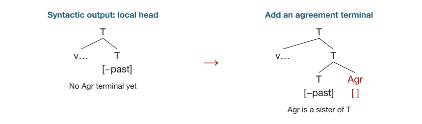{.dm-tree fig-alt="A local verbal head first has v and T minus past. Morphology adds an empty Agr terminal as a sister of T."}

There is now a place for the verb's agreement features.

## 10. Copy number; assign case

Copy **[plural]** from the subject onto **Agr** and **D**.

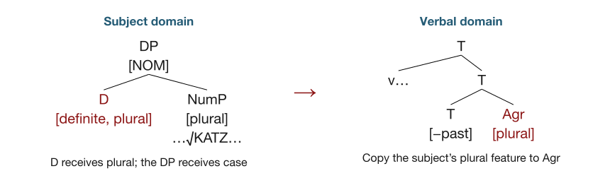{.dm-tree fig-alt="In the subject domain, D receives plural from the nominal structure and the DP has nominative case. In the verbal domain, Agr receives the subject's plural feature."}

The subject DP also receives **nominative case** from its clausal context.

## 11. Fuse tense and agreement

Combine the adjacent **T** and **Agr** terminals into one realization site.

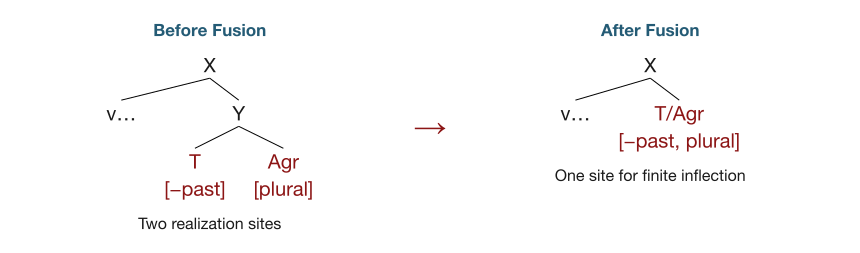{.dm-tree fig-alt="Separate T minus past and Agr plural terminals fuse into one T/Agr terminal containing both features."}

**[−past]** and **[plural]** both survive.

## 12. Insert the root pronunciations

The Vocabulary supplies forms for the selected roots in their grammatical contexts.

| Abstract root and context | Inserted form |
|---|---|
| √KATZ in the nominal context | **/katsə/**, *Katze* |
| √SCHNURR in the verbal context | **/ʃnʊr/**, *schnurr-* |

These pronunciations realize the roots that were selected earlier.

## 13. Realize the grammatical features

| Realization site | Exponent | Result |
|---|---|---|
| D[definite, plural], nominative context | **/diː/** | **die** |
| Nominal [plural], with √KATZ | **/-n/** | **Katze-n** |
| T/Agr[−past, plural], verbal context | **/-ən/** | **schnurr-en** |

The two plural endings have **different forms and different insertion contexts**.

## 14. Prepare and articulate the sound sequence

**/diː/ + /katsə/ + /n/ + /ʃnʊr/ + /ən/**

↓

**Die Katze-n schnurr-en.**  
‘The cats are purring.’

Phonology organizes the spoken forms. The articulator executes the plan.

## Must planning follow the derivation?

We built **nP → NumP → DP**, then a clause, then movement.

**Does a speaker have to plan it in that order?**

Could planning begin with **where the constituents will end up**, with their
lower positions already linked to those destinations?

## Could a familiar frame be ready to reuse?

Suppose a speaker often uses this pattern:

**[subject DP] + [finite verb] + …**

Could its structure become familiar enough to retrieve as a frame, with
places for new roots and features?

**How much of the sentence would still need to be planned?**

## Plan the destination and its lower positions

Place the cats' **DPᵢ** at its planned destination; reserve its lower positions.

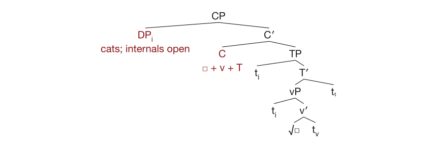{.dm-tree fig-alt="A proposed CP planning frame has a subject DP at the front and an unfilled verbal complex in C. Below C, TP contains a linked subject trace and T prime. Inside T prime, vP contains another subject trace and a verbal structure with an unfilled root and a lower v trace. A lower T trace is also reserved. The DP's internal structure remains unfilled."}

**Filled:** the subject's identity and destination. **Open:** internal content.

## How much structure comes with a trace?

**Do we plan only the lower positions, or their surroundings too?**

| Possible plan | What is reserved in advance? |
|---|---|
| Dependency links | A destination and its linked lower positions. |
| Local structure | Those positions plus sisters, complements, and attachment sites. |
| A fuller frame | Clause structure, argument positions, and feature relations. |

Where would you leave the tree underspecified?

## What would distinguish these planning options?

Compare reuse of **surface order**, **movement dependencies**, and
**complement structure**.

- Would the same order help when the predicate needs different complements?
- Would a frame help before its roots and number features are selected?
- Which unfilled positions could remain open when speaking begins?

**A reusable plan must still supply what DM needs for realization.**

## Now let something go wrong

Intended: **“I wanted to tie up the dog.”**  
Produced: **“I wanted to bark at the dog.”**

German: **anbind-en** ‘tie up’ → **anbell-en** ‘bark at’.

The concept **DOG** can activate a related, unintended action.

::: {.prompt}
Which part of the model needs access to these conceptual associations?
:::

## A wrong root can get the right morphology

Intended: **versuchte … zu kommen**, ‘tried … to come’.  
Error onset: **kam**, ‘came’.

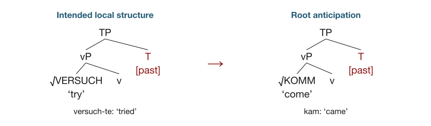{.dm-tree fig-alt="A simplified TP keeps T past fixed while root VERSUCH, try, is replaced by anticipated root KOMM, come. The resulting past form is kam."}

The displaced root is pronounced in its **new grammatical context**.

## What exactly was left behind?

| | Root in the finite position | Past realization |
|---|---|---|
| Intended | √VERSUCH ‘try’ | versuch-**te** |
| Error | √KOMM ‘come’ | **kam** |

The stranded element is **[past]**. Its pronunciation depends on the root
that occupies the context.

::: {.prompt}
Why would “the speaker just kept the suffix *-te*” miss the pattern?
:::

## A root can also land in a new category

Intended: **einen Blick geworfen**, ‘thrown a glance’.  
Produced: **einen Wurf geblickt**, approximately ‘glanced a throw’.

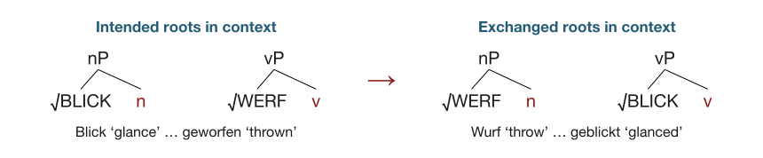{.dm-tree fig-alt="The intended nominal root BLICK and verbal root WERF exchange contexts. WERF under n is realized as Wurf; BLICK under v receives the participial realization geblickt."}

## The grammar keeps working after an error

| Altered representation | Ordinary grammatical consequence |
|---|---|
| √KOMM in a past context | Past realization: **kam** |
| √WERF in a nominal context | Nominal realization: **Wurf** |
| √BLICK in a participial verbal context | Participial realization: **geblickt** |

**Accommodation:** the produced form fits the context created by the error.

## Your turn: roots, tense, and pronunciation

| | Finite position: past | Infinitival position |
|---|---|---|
| Intended | **schien** ‘seemed’ | **zu drohen** ‘to threaten’ |
| Produced | **drohte** ‘threatened’ | **zu scheinen** ‘to seem’ |

1. What moved between the two positions?
2. What stayed in the finite position?
3. What determines the two new pronunciations?

## What does this architecture explain?

- **Selection:** the message activates specific abstract roots and features.
- **Combination:** syntax places roots in grammatical contexts.
- **Realization:** ordinary morphology produces context-appropriate forms,
  even when an earlier choice was wrong.

::: {.prompt}
Explain *kam* using these three steps. Where did the error occur?
:::

## Do roots and features need separate stores?

A speaker can produce the wrong root with the intended inflection, or the
intended root with the wrong inflection.

| Resource | What it supplies |
|---|---|
| Root store | Lexical content |
| Feature store | Grammatical specifications |
| Vocabulary | Phonological exponents |

Independent errors can motivate **separate representations**.

## Revising a developing utterance

**“The girl reads … writes a letter.”**

::: {.production-flow}
Conceptual planning ⇄ DM formulation ⇄ Local phonology → Articulation
:::

**Cognitive control** can influence selection, mapping, and revision.

::: {.prompt}
Which choice could be revised while the rest of the structure stays available?
:::

## Exit ticket

1. Where does **DM** fit into this production architecture?
2. Why must a root's **identity** be available before its pronunciation?
3. In **versuchte → kam**, what changes and what stays?
4. Why can the error's morphology follow from **ordinary realization**?

## Sources: DM and production {.smaller}

- **Pfau (2000).** [*Features and Categories in Language Production*.](https://dingo.sbs.arizona.edu/~hharley/courses/535/PfauThesis.pdf) Dissertation, Goethe University Frankfurt. Chapters 4 and 5.
- **Pfau (2009).** [*Grammar as Processor: A Distributed Morphology Account of Spontaneous Speech Errors*.](https://doi.org/10.1075/la.137)
- **Goryczka (2025).** *Grammar theory and language pathology: A Distributed Morphology account of verb production in aphasia*. §3.2.3 on Pfau; §6.1 on DMPAM. Course reading on ELMS.
- **Harley & Noyer (1999).** [“State-of-the-Article: Distributed Morphology.”](https://dingo.sbs.arizona.edu/~hharley/PDFs/HarleyNoyerDM1999.pdf)

## Further reading: possible implementations {.smaller}

- **Marcus (2013).** “Evolution, memory, and the nature of syntactic representation.” In *Birdsong, Speech, and Language*, pp. 27 to 40.
- **Keshev et al. (2025).** [“A working memory model of sentence processing as binding morphemes to syntactic positions.”](https://doi.org/10.1111/tops.12780)
- **Dell (1986).** [“A spreading-activation theory of retrieval in sentence production.”](https://doi.org/10.1037/0033-295X.93.3.283)
- **Caramazza (1997).** [“How many levels of processing are there in lexical access?”](https://cogneuro.psychology.fas.harvard.edu/publications/how-many-levels-processing-are-there-lexical-access)

## Extension: the same derivation in vectors

**Die Katzen schnurren.**

- Maintain small pieces of structure, such as the **subject DP** and the
  **finite verbal head**.
- Give roots and features **content vectors**.
- Bind those vectors to **positions within the structure**.

The representations can be numerical while retaining grammatical distinctions.

## A position is a role in the tree

{.dm-tree .compact-tree fig-alt="A local tree for the nominal KATZ root labels NumP with the root address epsilon, nP with L, Num plural with R, KATZ with LL, and n with LR."}

**ε** = root position · **L** = left branch · **R** = right branch

Bind a node's **content** to its **path**. The same root could occupy a different path.

## Bind content; retrieve with a position

$$
W = \sum_i \mathbf{v}_i\mathbf{p}_i^{\mathsf T}
\qquad
\widehat{\mathbf{v}}_i = W\mathbf{p}_i
$$

**$\mathbf{v}_i$:** what occupies a node. **$\mathbf{p}_i$:** where it belongs.

| In our utterance | Content to bind |
|---|---|
| Subject's nominal root position | √KATZ |
| Subject's Number position | [plural] |
| Finite head's verbal root position | √SCHNURR |
| Tense position | [−past] |

## A numerical example: copy plural to agreement

Columns are **Num** and **Agr**. Rows are **plural** and **nonpast**.

$$
W_{\text{before}}=
\begin{bmatrix}1&0\\0&0\end{bmatrix}
\quad\longrightarrow\quad
W_{\text{after}}=
\begin{bmatrix}1&1\\0&0\end{bmatrix}
$$

Cue the Agr column:
$W_{\text{after}}\begin{bmatrix}0\\1\end{bmatrix}
=\begin{bmatrix}1\\0\end{bmatrix}$ → **[plural]**.

Number remains on the noun and is now available for verbal agreement.

## Morphological operations become changes to bindings

| DM operation | One possible operation on the code |
|---|---|
| **Fusion** | Replace two terminal bindings with one combined feature bundle. |
| **Fission** | Rebind specified parts of one bundle to separate terminals. |
| **Impoverishment** | Remove a specified feature from a PF-side content vector. |

For our verb: **T [0, 1] + Agr [1, 0] → T/Agr [1, 1]**.

## Retrieve the bindings and realize them

| Retrieved content and context | Vocabulary result |
|---|---|
| √KATZ, nominal context | /katsə/ |
| [plural], at this nominal site | /n/ |
| √SCHNURR, verbal context | /ʃnʊr/ |
| [plural], at fused T/Agr | /ən/ |

Together with **D → /diː/**: **Die Katzen schnurren.**

## Could an LLM contain comparable information?

**Two things to look for:**

- A **direction or subspace** that distinguishes a grammatical feature
  across many different words.
- **Attention-head outputs or other components** that help use that
  information when predicting a form.

A syntactic head such as **Num** and an **attention head** are different kinds of object.

## Begin with controlled morphological contrasts

| Number | Prefix | Candidate continuation |
|---|---|---|
| Singular | **Die Katze** | **schnurrt** |
| Plural | **Die Katzen** | **schnurren** |
| Singular | **Der Hund** | **bellt** |
| Plural | **Die Hunde** | **bellen** |

Train an analysis on some roots; test it on **different roots and forms**.

## Find a candidate number direction

At layer $\ell$, compare paired representations:

$$
\mathbf{d}_{\ell}=\operatorname{mean}_{\text{pairs}}
\left(\mathbf{h}_{\ell,\mathrm{PL}}-
\mathbf{h}_{\ell,\mathrm{SG}}\right).
$$

Can a simple readout recover **number** for roots it has never seen in training?

Then ask which **head outputs and layers** carry or transform that information.

## Change the candidate; measure the form choice

1. Run singular and plural prefixes and save their activations.
2. Patch a candidate **head output or feature subspace** from the plural run
   into the singular run at the matched position.
3. Recompute the continuation probabilities.

Does preference shift from **schnurrt** toward **schnurren**?

## What would connect the findings back to DM?

| Finding | What it would support |
|---|---|
| Number can be decoded across roots. | A reusable grammatical distinction. |
| A selective intervention changes inflection. | That information contributes to form choice. |
| The same feature predicts different exponents in different contexts. | Context-sensitive realization. |

Identifying **Fusion, Fission, or Impoverishment** would require additional,
operation-specific tests.

## Sources for the vector and LLM extension {.smaller}

- **Marcus (2013)** and **Keshev et al. (2025)**: local structural memory and
  item-position binding, listed above.
- **Hewitt & Manning (2019).** [“A Structural Probe for Finding Syntax in Word Representations.”](https://aclanthology.org/N19-1419/)
- **Lasri et al. (2022).** [“Probing for the Usage of Grammatical Number.”](https://aclanthology.org/2022.acl-long.603/)
- **Mueller, Xia, & Linzen (2022).** [“Causal Analysis of Syntactic Agreement Neurons in Multilingual Language Models.”](https://aclanthology.org/2022.conll-1.8/)
- **Amini et al. (2023).** [“Naturalistic Causal Probing for Morpho-Syntax.”](https://aclanthology.org/2023.tacl-1.23/)
